

<picture></picture>

<picture></picture>

<picture></picture>

  

<picture></picture>

                         

<picture></picture>

    <a href="https://github.com/sid2428/sid2428/issues/new?title=ttt%3A+1+5&body=Just+hit+Submit.+The+bot+plays+your+move%2C+replies+here+and+closes+this+issue+in+under+a+minute.">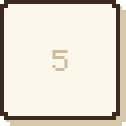</a> <a href="https://github.com/sid2428/sid2428/issues/new?title=ttt%3A+1+6&body=Just+hit+Submit.+The+bot+plays+your+move%2C+replies+here+and+closes+this+issue+in+under+a+minute.">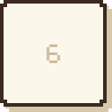</a> <a href="https://github.com/sid2428/sid2428/issues/new?title=ttt%3A+1+7&body=Just+hit+Submit.+The+bot+plays+your+move%2C+replies+here+and+closes+this+issue+in+under+a+minute.">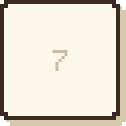</a> <a href="https://github.com/sid2428/sid2428/issues/new?title=ttt%3A+1+8&body=Just+hit+Submit.+The+bot+plays+your+move%2C+replies+here+and+closes+this+issue+in+under+a+minute.">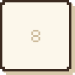</a> 

<picture></picture>

<picture>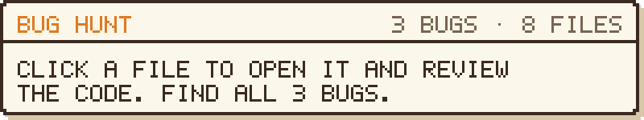</picture>

<picture></picture>
<picture>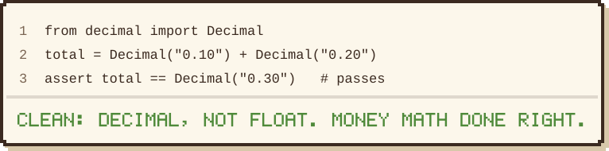</picture>

<picture></picture>
<picture>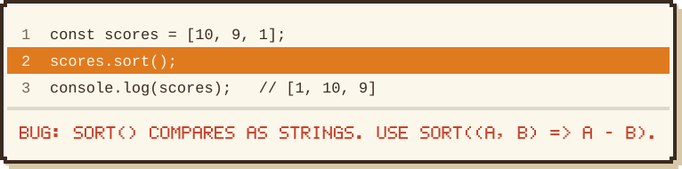</picture>

<picture></picture>
<picture>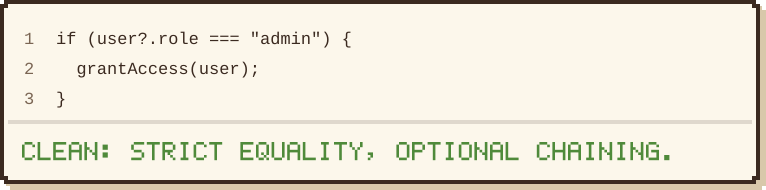</picture>

<picture></picture>
<picture>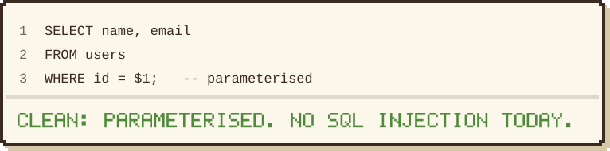</picture>

<picture></picture>
<picture>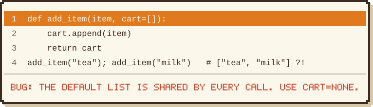</picture>

<picture></picture>
<picture>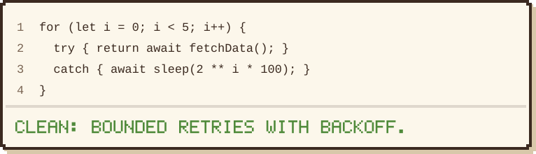</picture>

<picture></picture>
<picture>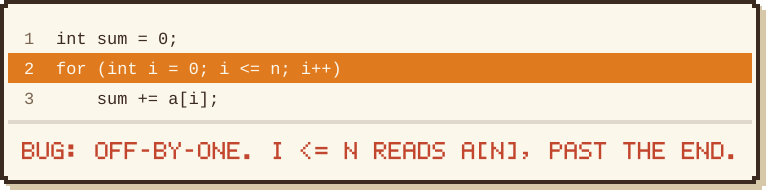</picture>

<picture></picture>
<picture>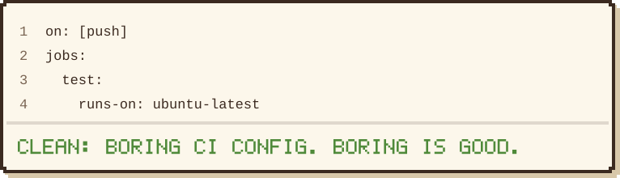</picture>

<picture></picture>

 

<picture></picture>

<picture></picture>

   

