<picture>
  <source media="(prefers-color-scheme: dark)" srcset="./dark.svg">
  <source media="(prefers-color-scheme: light)" srcset="./light.svg">
  
</picture>

I'm Kartik. I study E&TC at PICT Pune and spend most of my time building backends: Java and Spring Boot, Python and FastAPI, with Docker and CI/CD around them. The game above runs on its own. The quiz below needs you.

## Play along

<b>What does AEGIS do when one of its safety checks can't run?</b>

 
It blocks the payment. AEGIS fails closed: if the sanctions, spending-limit or policy check fails, or can't run at all, no money moves.

<b>Can an AI agent approve its own big payment in AEGIS?</b>

 
No. High-value payments need signed approval from separate approvers, and each approval is tied to the exact cart. Change one item and the approval is void.

<b>What did I ship at Bluestock Fintech in a single two-week sprint?</b>

 
The analytics module of a live financial dashboard: the SQL behind its tables, metrics and filters. I checked every figure against the source tables before sign-off.

<b>How do people log in to Studio Oak?</b>

 
Google sign-in or email OTP. Roles keep users and admins inside their own order and inventory endpoints.

<b>How many people have I mentored on DSA and backend?</b>

 
300+, answering 50+ doubts a month.

## Cast a vote

<!-- POLL:START -->
**Java or Python for your next backend?**

| Vote | Count | |
| --- | --: | --- |
| [**Java**](https://github.com/sid2428/sid2428/issues/new?title=vote%3A+java&body=Just+hit+Submit.+A+bot+counts+your+vote%2C+replies+and+closes+this+issue.) | 0 | `░░░░░░░░░░` |
| [**Python**](https://github.com/sid2428/sid2428/issues/new?title=vote%3A+python&body=Just+hit+Submit.+A+bot+counts+your+vote%2C+replies+and+closes+this+issue.) | 0 | `░░░░░░░░░░` |

0 votes so far. Click an option, submit the issue, and a bot adds your vote. Voting again changes your vote.
<!-- POLL:END -->

## Things I've built

**[AEGIS](https://github.com/sid2428/finance2)**: a checkpoint every AI-agent payment has to pass before money moves. Python, FastAPI, pytest, Docker. 85 tests plus 8 simulated attacks in CI, and all 8 are blocked.

**[Studio Oak](https://github.com/sid2428/Studio__Oak)**: a full-stack store with cart, checkout, orders, an admin panel and a support bot. React, Node.js, Express, MongoDB. Our team of four built the first version in 24 hours at IEEE TechRush and won, out of 40+ teams. I owned the backend.

## Where I've worked

**SDE Intern, Bluestock Fintech** (Apr – May 2026, remote): React, SQL, Agile. 
**Research Intern, Backend & DevOps** (Dec 2025 – Mar 2026, Pune): shipped 12+ features to a Spring Boot app with 200+ users, and moved a 5-service release process onto gated CI/CD, cutting release time from days to under 2 hours.

## Stack

Java · Spring Boot · Python · FastAPI · C++ · JavaScript · React · Node.js · Express · PostgreSQL · MySQL · MongoDB · Docker · GitHub Actions · JUnit · pytest · Linux

## Say hi

[LinkedIn](https://www.linkedin.com/in/kartikgaikwad) · [kartikgaikwad2828@gmail.com](mailto:kartikgaikwad2828@gmail.com)
